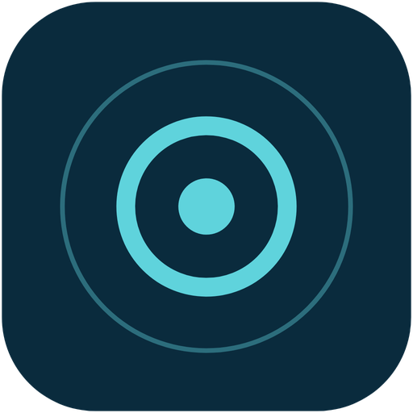
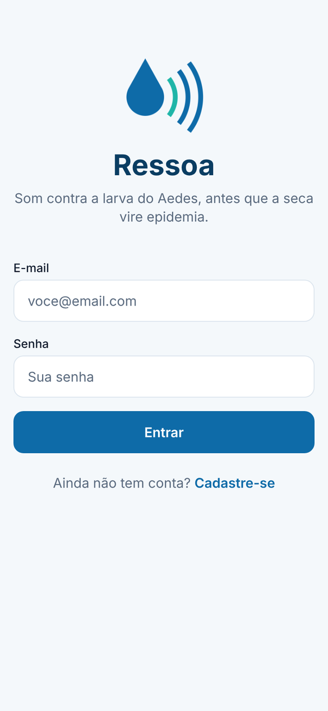
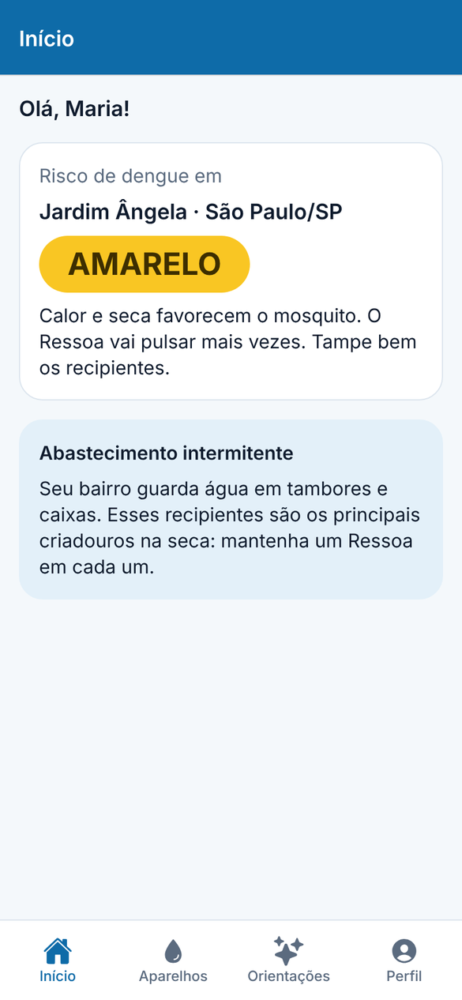
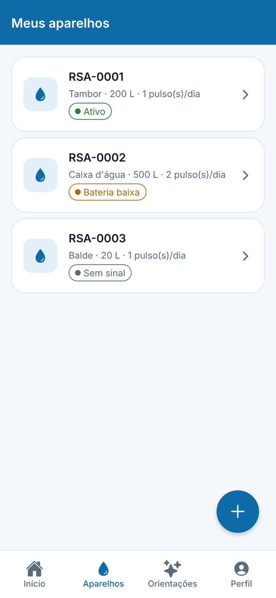
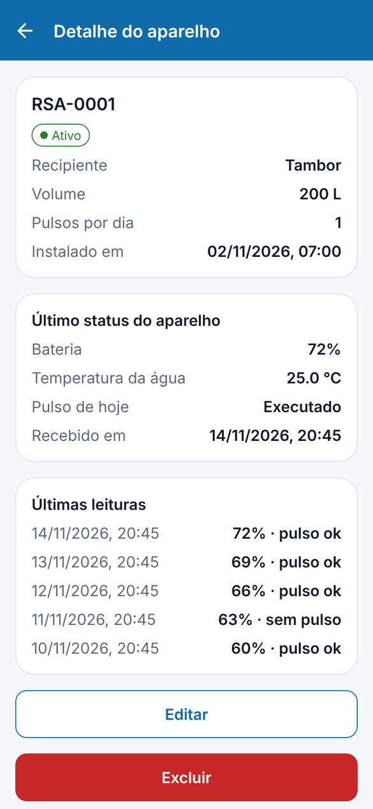
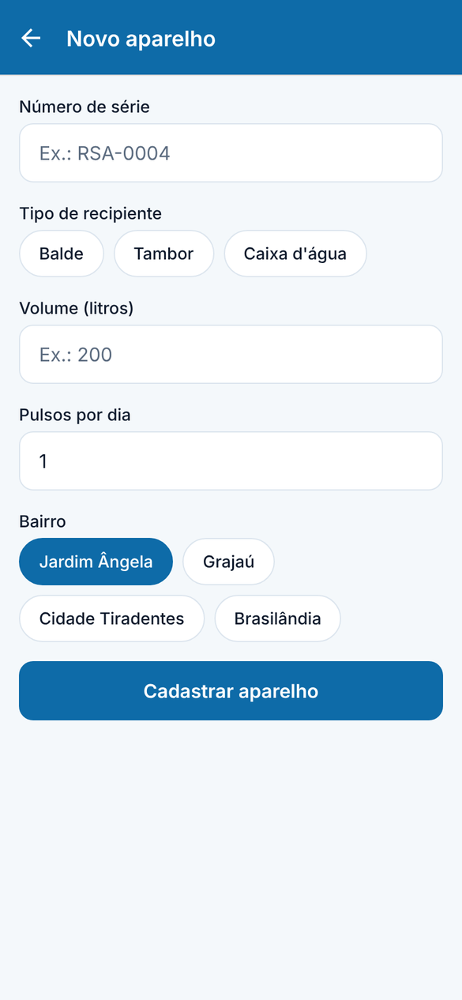
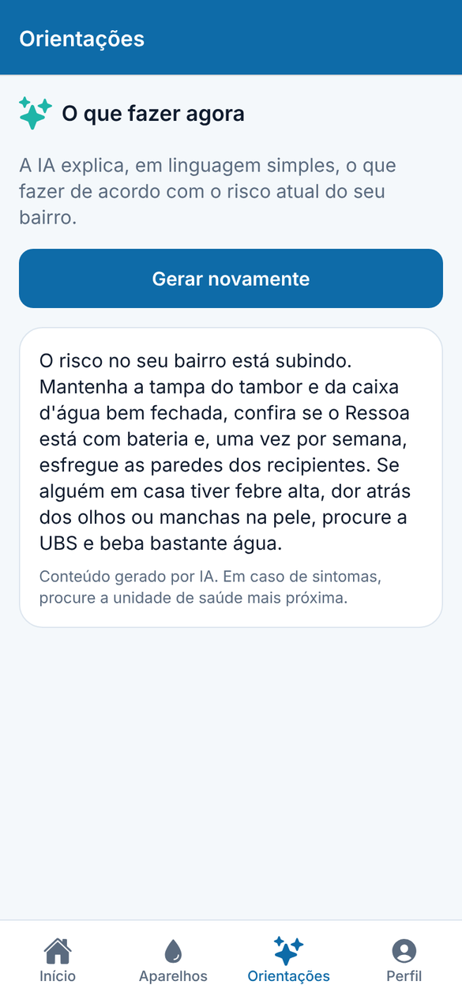

<div align="center">



# Ressoa · App Mobile

**Matar a larva do Aedes com som antes que a seca vire epidemia.**

Global Solution 2026/2 · FIAP · CitizenTech · Mobile Application Development


[Vídeo de demonstração](#-vídeo) · [Como rodar](#-como-rodar) · [Arquitetura](#-arquitetura) · [Publicação](#-publicação)

</div>

---

## 📌 Sobre o projeto

A dengue é o impacto do El Niño que mais mata no Brasil. Na seca, quem tem abastecimento de água intermitente guarda água em tambores e caixas, que viram criadouros do Aedes, e o risco de epidemia sobe de 3 a 5 meses depois.

O **Ressoa** tem duas partes:

- **O aparelho:** fica dentro do recipiente de água e emite um pulso curto de ultrassom por dia, que rompe a larva por dentro, sem veneno. Ele envia o status (bateria, temperatura da água, pulso executado) pela internet.
- **A plataforma:** cruza a previsão do El Niño, a seca, a temperatura e os casos de dengue para dizer onde instalar, quando intensificar e quem alertar.

**Este repositório é o app mobile.** Com ele, o morador cadastra os aparelhos instalados em casa, acompanha o status de cada um, vê o nível de risco de dengue do bairro e recebe uma orientação gerada por IA. O gestor da vigilância em saúde vê todos os aparelhos e recebe um plano de ação.

**Público:** moradores de periferia com água intermitente, com prioridade para famílias com bebês, gestantes e idosos, e agentes e gestores da vigilância em saúde do município.

## 📱 Telas

<table>
  <tr>
    <td align="center"><br /><b>Login</b></td>
    <td align="center"><br /><b>Início</b> · risco do bairro</td>
    <td align="center"><br /><b>Meus aparelhos</b></td>
  </tr>
  <tr>
    <td align="center"><br /><b>Detalhe</b> · telemetria</td>
    <td align="center"><br /><b>Novo/editar aparelho</b></td>
    <td align="center"><br /><b>Orientações</b> · IA</td>
  </tr>
</table>

| Tela | Rota | O que faz | API |
| --- | --- | --- | --- |
| Login | `/login` | Entrada com e-mail e senha | `POST /api/auth/login` |
| Cadastro | `/cadastro` | Cria a conta do cidadão (nome, e-mail, senha e bairro) | `GET /api/bairros` · `POST /api/auth/registro` |
| Início | `/inicio` | Nível de risco do bairro (VERDE, AMARELO, LARANJA ou VERMELHO) e o que fazer | `GET /api/bairros/{id}` |
| Meus aparelhos | `/aparelhos` | Lista paginada, com pull-to-refresh | `GET /api/dispositivos` |
| Novo/editar aparelho | `/aparelho/form` | Cria ou edita um aparelho, com validação | `POST` · `PUT /api/dispositivos` |
| Detalhe do aparelho | `/aparelho/[id]` | Dados, último status e histórico de leituras; editar e excluir | `GET` · `DELETE /api/dispositivos/{id}` + API .NET |
| Orientações | `/orientacoes` | Orientação ao morador ou plano de ação ao gestor, gerados por IA | `POST /api/bairros/{id}/orientacao` |
| Perfil | `/perfil` | Dados da conta e logout | — |
| Sobre o App | `/sobre` | Versão e hash do commit publicado | — |

## ✅ Requisitos da disciplina

| Requisito | Como foi atendido |
| --- | --- |
| **1. Telas e navegação** | 8 telas + "Sobre o App" com Expo Router: Stack para o fluxo e abas para a área logada |
| **2. CRUD com API** | CRUD completo de aparelhos na API Java via Axios, com loaders, mensagens de erro e "tentar de novo". Status e histórico vêm da API .NET |
| **3. Autenticação** | Cadastro e login reais com JWT, sessão no SecureStore, rotas protegidas com `Stack.Protected`, logout que limpa a sessão e encerramento automático ao receber 401 |
| **4. Estilização** | Identidade visual própria: paleta azul-água, fonte Inter, logo, ícone e splash. Áreas de toque de 44 a 50 px, rótulos de acessibilidade e risco sempre com cor **e** texto |
| **5. Arquitetura** | Pastas por responsabilidade (telas, componentes, services, contexto, tema, tipos, utilitários), TypeScript estrito, ESLint e Prettier |
| **6. Vídeo** | [Link na seção Vídeo](#-vídeo) |
| **7. Publicação** | Firebase App Distribution. A tela "Sobre o App" mostra o hash do commit do build |

## 🏗 Arquitetura

```text
src/
├── app/                  # Navegação (Expo Router): cada arquivo é uma tela
│   ├── _layout.tsx       # Fontes, AuthProvider e proteção de rotas
│   ├── index.tsx         # Entrada: redireciona para /inicio ou /login
│   ├── (auth)/           # Públicas: login e cadastro
│   └── (app)/            # Protegidas: abas, detalhe, formulário e "Sobre"
├── components/           # Componentes visuais reutilizáveis
├── contexts/             # AuthContext: sessão, login, cadastro e logout
├── hooks/                # Hooks de dados (useBairros)
├── services/             # Acesso às APIs REST (Axios), um arquivo por recurso
│   └── mock/             # API simulada em memória (só para desenvolvimento)
├── theme/                # Cores, tipografia e espaçamentos
├── types/                # Tipos do modelo de dados comum da solução
└── utils/                # Validações, formatação, erros, armazenamento e JWT
assets/
├── fonts/                # Inter
└── images/               # Logo, ícone e splash
```

```text
[App Mobile] ──login, cadastro, CRUD, risco, IA──▶ [API Java · Spring Boot] ──▶ Oracle
     │
     └──────status e histórico do aparelho───────▶ [API .NET · Telemetria] ──▶ Oracle
```

**Decisões principais:**

- **As telas não chamam o Axios diretamente.** Elas usam os `services`, que concentram as rotas. Se uma rota mudar, muda só o service.
- **Um único JWT para as duas APIs.** O `api.ts` cria duas instâncias do Axios (Java e .NET) com o mesmo interceptor, que envia o `Authorization: Bearer`.
- **Proteção de rotas no layout raiz.** Com `Stack.Protected`, sem sessão só o grupo `(auth)` existe; com sessão, só o `(app)`.
- **Falha parcial tratada.** Se a API .NET estiver fora do ar, o detalhe do aparelho continua funcionando e só avisa que a telemetria está indisponível.

### Bibliotecas

| Biblioteca | Por quê |
| --- | --- |
| `expo-router` | Navegação baseada em arquivos, com proteção de rotas |
| `axios` | Cliente HTTP com interceptors para o token e o tratamento de 401 |
| `expo-secure-store` | Guarda o JWT no Keychain/Keystore, e não em texto aberto |
| `expo-font` | Carrega a fonte Inter de `assets/fonts` |
| `@expo/vector-icons` | Ícones das abas e dos cards |
| `eslint` · `prettier` | Padronização e formatação do código |

As demais dependências vêm do template oficial do Expo e são exigidas pelo Expo Router.

## 🚀 Como rodar

**Pré-requisitos:** Node.js LTS e o app **Expo Go** no celular (ou um emulador Android).

```bash
git clone https://github.com/FelipeConteFerreira/NOME-DO-REPO.git
cd NOME-DO-REPO
npm install
cp .env.example .env
npx expo start
```

Leia o QR code com o Expo Go, ou aperte `w` para abrir no navegador.

### Variáveis de ambiente

| Variável | Descrição |
| --- | --- |
| `EXPO_PUBLIC_JAVA_API_URL` | URL da API Java (sem barra no final) |
| `EXPO_PUBLIC_DOTNET_API_URL` | URL da API .NET (sem barra no final) |
| `EXPO_PUBLIC_USE_MOCK` | `true` usa a API simulada; `false` usa as APIs reais |

> Variáveis `EXPO_PUBLIC_` ficam embutidas no app: elas só guardam URLs, nunca senhas ou chaves. O `.env` não vai para o Git.

### Usuários de teste

| Papel | E-mail | Senha |
| --- | --- | --- |
| Cidadão | `cidadao@ressoa.com` | `123456` |
| Gestor | `gestor@ressoa.com` | `123456` |

### Scripts

```bash
npm run lint        # ESLint
npm run format      # Prettier
npm run typecheck   # TypeScript
```

## 📦 Publicação

O app está publicado no **Firebase App Distribution** (APK Android gerado com EAS Build).

```bash
eas build -p android --profile preview
```

As URLs públicas das APIs ficam no perfil `preview` do `eas.json`, porque o EAS Build não lê o `.env`. O commit publicado é marcado com uma tag (`v1.0.0`), e a tela **Sobre o App** mostra o mesmo hash.

## 🎬 Vídeo

▶️ **[Assista à demonstração no YouTube](LINK-DO-VIDEO)**

## 👥 Integrantes

| Nome | RM |
| --- | --- |
| Altamir Lima | RM562906 |
| Felipe Conte | RM562248 |
| Luiz Gustavo | RM564495 |
| Olavo Porto Neves | RM563558 |
| Pedro Henrique Dias França | RM561940 |

## 🤖 Declaração de uso de IA

| Ferramenta | Uso |
| --- | --- |
| Claude (Anthropic) | Estrutura inicial do projeto, organização de pastas, componentes base, capturas de tela e revisão de código. Todo o código foi revisado e testado pelo grupo. |
